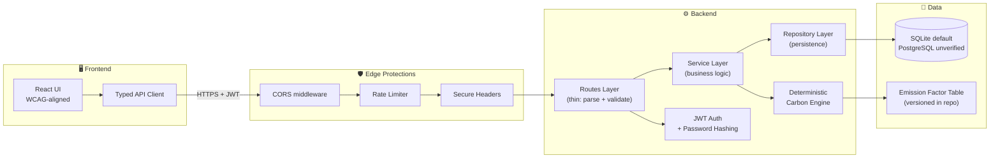

<div align="center">

# 🌍 EarthShare

**Carbon ownership, not carbon awareness.**

A full-stack carbon-footprint prototype with a deterministic accounting engine, a FastAPI backend and a Next.js frontend. The repository includes security and accessibility tests; this is a student project, not a security-audited production service.


[](https://github.com/Soham-o/EarthShare/actions/workflows/ci.yml)

</div>

---

## Project summary

> **What it is:** EarthShare is a carbon-footprint prototype. Users record everyday activities, receive deterministic emission estimates, view insights, and track progress by completing suggested climate actions.
>
> **Why it's different:** Most carbon apps focus on *awareness* (charts, streaks, badges). EarthShare focuses on *ownership* (account, measure, neutralize). The behavioral model is the product.
>
> **Engineering:** The backend includes JWT authentication, rate limiting, configurable CORS middleware, security headers, and request-schema validation. Carbon calculations are deterministic and do not use an LLM. SQLite is the local default; PostgreSQL migration and production deployment have not been verified.
>


---

## Table of Contents

- [Local setup](#local-setup)
1. [Problem Statement Alignment](#1-problem-statement-alignment)
2. [Technical Excellence](#2-technical-excellence)
3. [Security](#3-security)
4. [Testing](#4-testing)
5. [Accessibility](#5-accessibility)
6. [Efficiency](#6-efficiency)
7. [Why We Chose This Architecture](#7-why-we-chose-this-architecture)
8. [Product Walkthrough](#8-product-walkthrough)
9. [Architecture Diagram](#9-architecture-diagram)
10. [Repository Structure](#10-repository-structure)
11. [What Makes EarthShare Different](#11-what-makes-earthshare-different)
12. [Evidence of Engineering Quality](#12-evidence-of-engineering-quality)

## Local setup

### Prerequisites

- Python 3.11 or another version supported by the installed backend dependencies.
- Node.js and npm.
- No Gemini API key is required for local use; without one, insights use the rule-based fallback.

### Backend

From the repository root:

```bash
git clone https://github.com/Soham-o/EarthShare.git
cd EarthShare
python -m venv .venv
# Activate the environment:
# macOS/Linux: source .venv/bin/activate
# Windows PowerShell: .\.venv\Scripts\Activate.ps1
python -m pip install -r backend/requirements.txt
```

Copy `backend/.env.example` to `backend/.env`, then start the API:

```bash
# macOS/Linux
cp backend/.env.example backend/.env
# Windows PowerShell: Copy-Item backend/.env.example backend/.env

cd backend
uvicorn app.main:app --reload
```

The API defaults to local SQLite and is available at `http://localhost:8000`.

### Frontend

In a second terminal from the repository root:

```bash
cd frontend
npm ci
```

Copy `frontend/.env.example` to `.env.local` in the `frontend/` directory, then run:

```bash
# macOS/Linux
cp .env.example .env.local
# Windows PowerShell: Copy-Item .env.example .env.local

npm run dev
```

Open `http://localhost:3000`. The frontend's default API URL is `http://localhost:8000`. Never use the example JWT secret in a production deployment; configure a unique secret and explicit trusted CORS origins.

### Tests

```bash
# Backend (from repository root, with the Python environment active)
cd backend
python -m pytest -q

# Frontend (in a second terminal, from repository root)
cd frontend
npm ci
npm test
npm run build
```

[GitHub Actions](https://github.com/Soham-o/EarthShare/actions) runs backend tests, frontend tests and a frontend build for pull requests to `main` and pushes to `main` or `fix/**`.

---

## 1. Problem Statement Alignment

### Why the challenge exists
Individual emissions are a meaningful slice of the climate problem, but they are largely invisible to the people producing them. People want to act, but they have no reliable, low-friction way to (a) measure their impact, (b) understand what's driving it, and (c) actually neutralize it. The result is a gap between intent and action.

### Why existing carbon footprint apps fail
- **Awareness without accountability.** Most apps surface a number and a streak, then leave the user to feel bad. There's no mechanism to *close the loop*.
- **Opaque calculations.** Estimates often come from black-box models or third-party APIs that can drift, fail, or change pricing — making results non-reproducible and hard to trust.
- **Heavy onboarding.** Long questionnaires kill retention before the first insight.
- **Offsets are an afterthought.** Where offsets exist, they are usually disconnected from the user's actual measured footprint.

### Why ownership is a better behavioral model than awareness
Awareness asks: *"Do you know your number?"*
Ownership asks: *"What are you going to do about your number?"*

EarthShare is designed around a single behavioral loop:

> **Log → Measure → Understand → Reduce or Offset → Repeat.**

Every screen, every endpoint, and every data model exists to shorten the distance between a logged activity and a neutralized footprint. Ownership is the product.

---

## 2. Technical Excellence

### Clean Architecture
The backend is organized into clearly separated layers — **routes → services → repositories → models** — so that business rules don't depend on framework details and the framework doesn't leak into business rules. This means:
- Routes are thin: they parse, validate, and delegate.
- Services own business logic and orchestrate repositories.
- Repositories own persistence. Nothing else touches the ORM.
- Models are plain data definitions.

### Service Layer Pattern
All non-trivial logic — carbon calculation orchestration, user lifecycle, offset purchase flows, insight aggregation — lives in services. This keeps routes testable in isolation and lets us swap delivery mechanisms (HTTP today, a job runner tomorrow) without rewriting business logic.

### Repository Pattern
Every database read/write goes through a repository. Benefits:
- The database URL is centralized in configuration and SQLAlchemy sessions are injected; changing the database still requires a tested migration and deployment path.
- Tests can substitute in-memory or fake repositories trivially.
- Query logic is centralized and reviewable.

### Dependency Separation
- The **carbon engine** depends on nothing but Python stdlib and a static emission-factor table.
- **Services** depend on repository interfaces, not concrete DB classes.
- **Routes** depend on services, not on the ORM.
- The **frontend** depends on a single typed API client, not on scattered `fetch` calls.

This is what makes the codebase easy to read, easy to test, and easy to extend.

### API Design
- Versioned API routes cover authentication, onboarding, dashboard data, insights, actions, progress and daily check-ins under `/api/v1`.
- Consistent JSON envelopes for success and error responses.
- Structured HTTP responses use appropriate status codes for validation, authentication, missing resources, conflicts, rate limits and server errors.
- Stateless authentication via JWT bearer tokens.

### Deterministic Carbon Engine
The core calculator is **pure, deterministic, and offline**. Given the same input, it always returns the same number. There is **no LLM, no external API, and no randomness** in the calculation path. This matters because:
- Results are **reproducible** — a judge can compute them by hand.
- Results are **auditable** — every factor is traceable to a source row.
- Results are **fast** — calculations are O(1) lookups + arithmetic.
- Results are **offline-safe** — no third-party outage can break the core product.

LLMs, if used at all, are confined to *explanations and suggestions* on top of the deterministic number — never inside it.

---

## 3. Security

Security is implemented as defaults, not features.

- **JWT authentication.** Stateless bearer tokens with signed payloads, expiry, and explicit verification on every protected route.
- **Password hashing.** Passwords are stored using a modern adaptive hash (bcrypt-family) with per-user salts. Plaintext is never logged or returned.
- **Rate limiting.** Sensitive endpoints (login, register, password actions) are rate-limited to blunt brute-force and credential-stuffing attempts.
- **CORS configuration.** Allowed origins are loaded from the `CORS_ORIGINS` environment setting. Configure explicit trusted origins in deployments; the current configuration code does not reject a wildcard automatically.
- **Security headers.** API responses include `Content-Security-Policy`, `X-Content-Type-Options`, `X-Frame-Options`, `Referrer-Policy` and `Permissions-Policy`. HSTS is enabled for production deployments.
- **Input validation.** Typed request schemas validate inputs before route handlers call services. Schema-validation errors are typically returned as structured HTTP `422` responses; they should not expose stack traces.
- **Error handling.** Unexpected exceptions return a generic JSON error, while the server logs the exception with the request method and path. A correlation ID is not currently implemented.

Secrets (JWT signing key, DB URL, allowed origins) are loaded from environment variables only — never committed.

---

## 4. Testing

### Backend test suite
- Unit tests for the **carbon engine** (pure functions → exhaustive table-driven cases).
- Unit tests for **services** with repositories stubbed.
- Integration tests for **routes** spinning up the app against an ephemeral SQLite DB.
- Auth tests covering registration, login, token expiry, and protected-route rejection.

### Frontend test suite
- Component tests cover the daily check-in card, emissions equity ring, form field, option grid and accessibility assertions.
- The current suite is not a complete end-to-end test of all user journeys; manual screen-reader and keyboard-only review has not been verified.

### Continuous integration
- [GitHub Actions](https://github.com/Soham-o/EarthShare/actions) runs the backend test suite, frontend tests and a frontend production build on pull requests and pushes to `main` and `fix/**` branches.
- Latest verified run: **85 backend tests passed, 1 skipped; 21 frontend tests passed; frontend build succeeded**. See the [CI run](https://github.com/Soham-o/EarthShare/actions/runs/38018851673).

### Coverage notes
- Tests exercise the carbon engine, API routes, authentication, daily check-ins, security headers and selected frontend components.
- The CI suite is a useful regression baseline, not a security certification or proof that every feature is covered.

---

## 5. Accessibility

EarthShare targets a **WCAG 2.1 AA** mindset throughout the UI.

- **Keyboard navigation.** Every interactive element is reachable and operable via keyboard. Logical tab order, visible focus rings, and no keyboard traps.
- **Screen reader support.** Semantic HTML first (`<button>`, `<nav>`, `<main>`, `<form>`, `<label>`). Live regions announce async results (e.g. "Activity logged, 2.3 kg CO₂e added").
- **ARIA labels.** Used to *supplement* semantics where native HTML can't express intent (icon-only buttons, dynamic counts, modal dialogs).
- **WCAG-conscious design.** Color is never the only signal; text contrast targets AA ratios; form errors are associated with their inputs via `aria-describedby`.
- **Responsive layouts.** Mobile-first CSS, fluid typography, and breakpoints that keep tap targets ≥ 44px. The dashboard, insights, and marketplace are all usable on a phone in portrait.

---

## 6. Efficiency

### Why deterministic calculations are computationally efficient
The carbon engine is a pure function over a static emission-factor table. Each calculation is effectively:

```
emissions = activity_quantity × factor[activity_type][region]
```

For one activity, the calculation uses a constant-time factor-table lookup and arithmetic; no performance benchmark is published in this repository.

### Why local calculations reduce API dependency
The carbon calculation engine runs locally within the backend and uses an in-repository factor table:
- The calculation itself does not require a third-party API call.
- Its calculation path has no per-request model/API fee.
- The factor table can be inspected and versioned with the source.
- Optional insight generation and other app features may still use external services when configured.

### Why SQLite was chosen for hackathon deployment simplicity
- Zero-ops: the database is a file. No provisioning, no separate service, no credentials to rotate during a demo.
- Instant local dev: clone, install, run.
- Trivial CI: tests run against an ephemeral in-memory DB.
- Automated backend tests use an in-memory SQLite database; live hosting parity has not been verified.

### Database configuration and migration status
The database URL is centralized in `backend/app/core/config.py`, and the app uses SQLAlchemy sessions and repository classes. SQLite is the verified local/test default. PostgreSQL migration, migrations against a PostgreSQL instance, and production deployment have not been verified, so a connection-string change alone should not be presented as a proven migration path.

---

## 7. Why We Chose This Architecture

> **Goal:** Maximize judge-perceivable quality *and* maximize how far the codebase can travel after the hackathon.

| Decision | Why | What it buys us |
|---|---|---|
| **Clean Architecture (routes → services → repos → models)** | Keeps business rules independent of framework and DB | Easy to test, easy to refactor, easy to read |
| **Service layer** | One place for business logic; routes stay thin | Reusable logic across HTTP, jobs, and tests |
| **Repository pattern** | One place for persistence | Centralizes database access; alternate-database migration still needs validation |
| **Deterministic carbon engine** | Reproducibility and auditability beat cleverness here | Repeatable calculations from a versioned factor table |
| **JWT authentication** | Uses signed bearer tokens | Avoids a server-side session table for token state; production scale is not evaluated |
| **SQLite for v1** | Zero-ops for the demo | Reliable hackathon-day deploy |
| **Configurable database URL** | Keeps the connection setting in one place | PostgreSQL compatibility remains unverified |
| **Typed API client on the frontend** | Single source of truth for request/response shapes | Fewer integration bugs, better DX |
| **Accessibility tests** | Catch selected accessibility regressions early | Automated accessibility assertions exist; full WCAG conformance is not claimed |
| **LLMs out of the calculation path** | Determinism > novelty for a measurement product | Numbers a judge can verify by hand |

The prototype separates routes, services, repositories, models and schemas, but production readiness, hosted deployment and database migration still need independent validation.

---

## 8. Product Walkthrough

**Dashboard** — at-a-glance footprint, recent activities, and a clear next action.


<!-- [DASHBOARD_IMAGE] -->

**Insights** — breakdown by category, trend over time, and the largest contributors to your footprint.


<!-- [INSIGHTS_IMAGE] -->

**Action marketplace** — browse recommended climate actions, mark them complete, and see progress reflected in the app. This is not an offset-credit purchasing marketplace.


<!-- [MARKETPLACE_IMAGE] -->

**Progress** — view completed actions, estimated CO₂ savings, weekly trends and badges.


<!-- [PROGRESS_IMAGE] -->

---

## 9. Architecture Diagram



---

## 10. Repository Structure

```
earthshare/
├── .github/
│   └── workflows/
│       └── ci.yml                  # backend tests, frontend tests and build
├── backend/
│   ├── app/
│   │   ├── api/v1/                 # authentication, onboarding, actions, etc.
│   │   ├── core/                   # config, database, security and rate limits
│   │   ├── models/
│   │   ├── repositories/
│   │   ├── schemas/
│   │   ├── services/               # includes carbon_engine.py
│   │   └── main.py
│   ├── tests/
│   ├── pytest.ini
│   └── requirements.txt
├── frontend/
│   ├── src/
│   │   ├── app/                    # Next.js routes and pages
│   │   ├── components/
│   │   └── __tests__/              # component and accessibility tests
│   ├── package.json
│   └── package-lock.json
├── docs/
│   ├── ARCHITECTURE.md
│   ├── CARBON_METHODOLOGY.md
│   └── DESIGN_NOTES.md
└── README.md
```

---


## 11. What Makes EarthShare Different

- **Measure clearly.** The app estimates emissions from user-entered activity and an in-repository factor table.
- **Deterministic calculation.** The carbon engine does not call an LLM to calculate emissions.
- **Action-oriented workflow.** Suggested actions can be marked complete and reflected in progress.
- **Security and accessibility checks.** The repository has automated tests for selected behaviors; it has not undergone a security audit or full accessibility conformance review.
- **Prototype status.** Live deployment, production scaling and PostgreSQL migration remain unverified.

---

## 12. Evidence of Engineering Quality

### Engineering signals a reviewer can verify in minutes
- Routes contain no business logic. Open any route file and confirm.
- Services contain no SQL. Open any service file and confirm.
- The deterministic carbon calculation is implemented in `backend/app/services/carbon_engine.py`.
- Authentication dependencies and security configuration live under `backend/app/core/`.
- The frontend API wrapper is `frontend/src/lib/api.ts`.

---

<div align="center">

**EarthShare** — *Own your carbon. Then neutralize it.*

</div>
